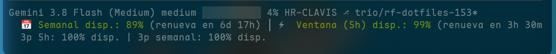
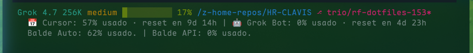

# Status lines

Status lines para [Cursor](https://cursor.com) y [agy](https://antigravity.google). Muestran el modelo, el context window de la sesión, el directorio, la rama y la cuota del plan.



agy muestra lo que queda disponible. El semanal y la ventana de 5 horas son Gemini e incluyen cuándo se renuevan. El tercer renglón es Claude y GPT.



Cursor muestra lo que queda, en rojo desde el 80% usado. Auto, Composer y Grok comparten una cubeta; Claude, GPT y Gemini, la otra. Si la cubeta que gasta el modelo de la sesión está agotada, esa frase va primero. Esas dos renuevan al fin del billing cycle. Grok.com tiene su propio reloj. El porcentaje de la primera línea, en las dos, es el context window, no la cuota.

## Herramientas

Hacen falta `bash`, `make`, `git`, `jq` y `flock`. La status line de Cursor también usa `secret-tool`.

Arch Linux:

```bash
sudo pacman -S --needed bash git jq libsecret make util-linux
```

`secret-tool` está en el paquete `libsecret`. `flock` está en `util-linux`.

Ubuntu:

```bash
sudo apt install bash git jq libsecret-tools make util-linux
```

`secret-tool` está en `libsecret-tools` (componente universe de Ubuntu 24.04). `flock` está en `util-linux`.

Cursor y agy se instalan aparte, cada uno con su sesión iniciada.

## Instalar

```bash
make
make doctor
make install
```

`make install` escribe bajo `$HOME`:

- `$HOME/.config/cursor/statusline.sh`
- `$HOME/.config/agy/statusline.sh`
- la clave `statusLine` en la config de Cursor y de agy

Actualiza únicamente esa clave. Si el JSON ya existía y cambia, deja una copia `archivo.bak-fecha`.

Abrí una sesión nueva de cada herramienta para que lea la config.

## Quitar

```bash
make uninstall
```

Quita `statusLine` solo si apunta a estos scripts, y borra los scripts.

## Plataformas

Probado en Linux. En Windows y en macOS no está probado.

Está armado para Linux. Los scripts son bash, las rutas salen de `$HOME`, la cuota de Cursor se lee con `secret-tool` (Secret Service) y el refresh usa `flock`. En macOS el llavero es el Keychain. En Windows nativo no hay `secret-tool` ni este `flock`.
